<p align="center">
  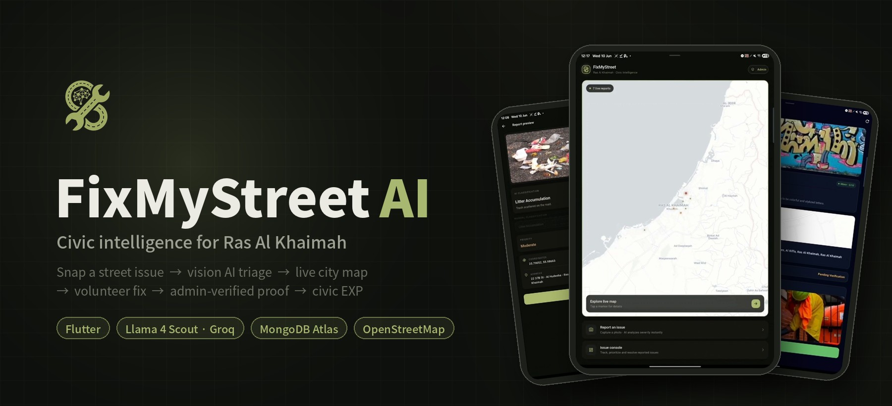
</p>

<p align="center">
  
  
  
  
  
  
</p>

<h3 align="center">Every phone becomes a municipal sensor.<br>Every report becomes a work order.<br>Every resident becomes part of the repair crew.</h3>

---

## Introduction

A pothole on Al Muntasir Road. A junction box with copper wiring spilling out at child height. A wall of fresh graffiti in Al Riffa. In most cities, these problems wait. They wait for someone to find the right phone number, for a clerk to decode a vague description, for a supervisor to guess how serious it is, and for a crew to work out where it actually is.

**FixMyStreet AI removes the waiting.**

A resident points their camera at the problem. Within seconds, a **multimodal mixture-of-experts vision model (17B active parameters)** looks at the photo the way a senior municipal inspector would. It names the defect against a fixed **15-class infrastructure taxonomy**, scores the danger on a **1–10 severity scale**, and writes a factual field note. The phone's GPS fixes the report to **exact coordinates**, and reverse geocoding turns those into a street address. The issue appears on a **live, severity-coded map of Ras Al Khaimah** for every resident and every city administrator at once.

That first step starts a **closed-loop civic system**:

- **Deterministic severity reconciliation.** The model proposes a severity, and a canonical rule table decides it, so an AI misjudgement can never move a dangerous job onto a volunteer's list.
- **A role-aware state machine.** It sends high-risk hazards to city crews and opens low-risk fixes to the community.
- **Proof-of-work verification.** A volunteer's after photo sits next to the original report until a city admin signs it off.
- **A civic EXP economy.** Residents earn points for reporting problems and more for fixing them.

> **Snap → Classify → Map → Volunteer → Prove → Verify → Reward.**
> One tap starts it. The city's live picture updates every three seconds.

Built in Flutter for Ras Al Khaimah, UAE.

---

## Contents

- [The 10-second report](#-the-10-second-report)
- [Feature tour](#-feature-tour)
  - [1 · Role-based entry](#1--role-based-entry)
  - [2 · Live civic map](#2--live-civic-map)
  - [3 · Vision AI triage](#3--vision-ai-triage)
  - [4 · Issue Console](#4--issue-console)
  - [5 · Severity guardrail](#5--severity-guardrail)
  - [6 · Volunteer → Proof → Verify pipeline](#6--volunteer--proof--verify-pipeline)
  - [7 · Civic EXP economy](#7--civic-exp-economy)
  - [8 · Self-healing data layer](#8--self-healing-data-layer)
- [System architecture](#-system-architecture)
- [The issue taxonomy](#-the-issue-taxonomy)
- [Data model](#-data-model)
- [Tech stack](#-tech-stack)
- [Project structure](#-project-structure)
- [Getting started](#-getting-started)
- [Roadmap](#-roadmap)
- [Team](#-team)

---

## ⚡ The 10-second report

<table>
  <tr>
    <td align="center" width="25%">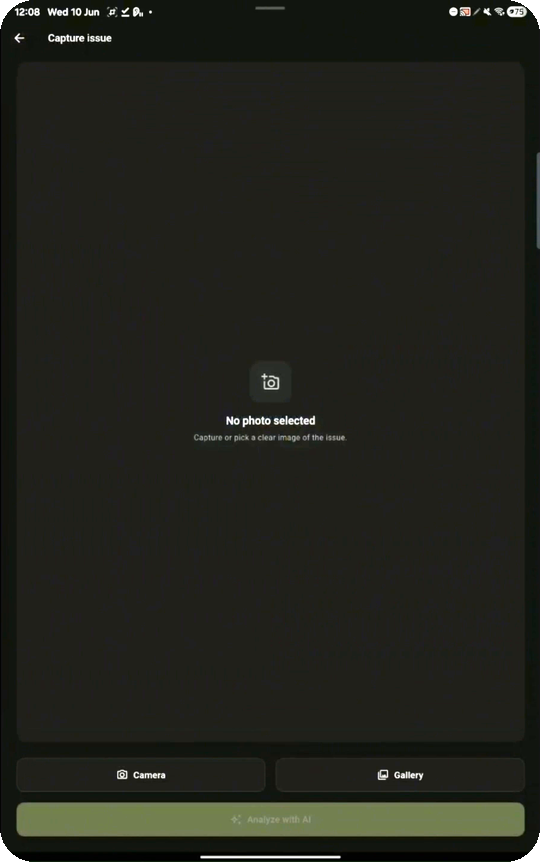<br><b>1. Capture</b><br><sub>Camera or gallery</sub></td>
    <td align="center" width="25%">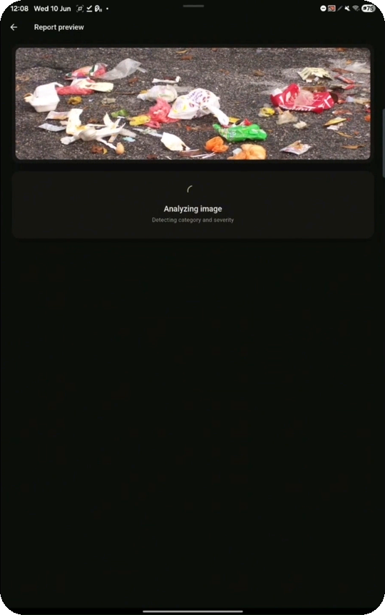<br><b>2. Analyze</b><br><sub>Llama 4 Scout inspects the image</sub></td>
    <td align="center" width="25%">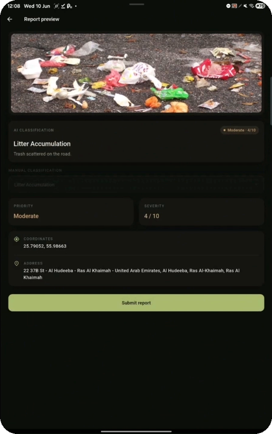<br><b>3. Review</b><br><sub>Category · severity · GPS · address</sub></td>
    <td align="center" width="25%">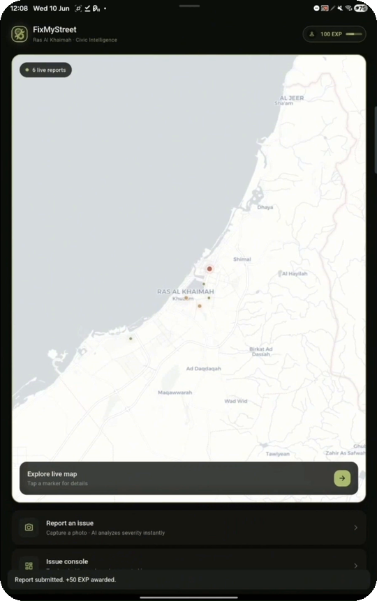<br><b>4. Submitted</b><br><sub>Live on the map · <b>+50 EXP</b></sub></td>
  </tr>
</table>

The resident adds no form fields, no category menu and no typed description. The model and the device sensors provide everything the city needs to act.

---

## 🧭 Feature tour

### 1 · Role-based entry

<table>
  <tr>
    <td width="260">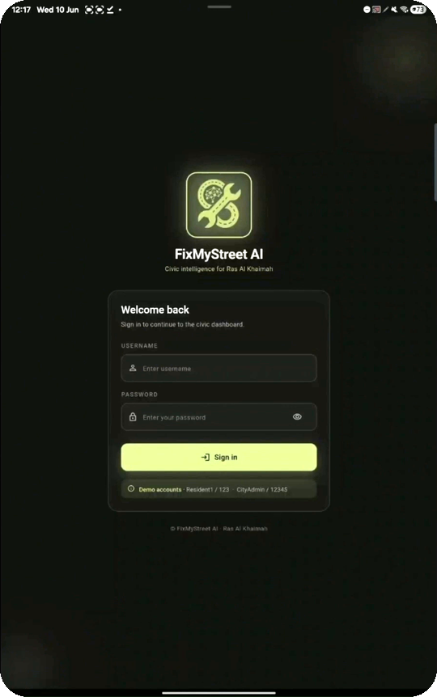</td>
    <td>

The app opens on a branded sign-in screen and resolves each account to one of two roles:

| Role | What they can do |
|---|---|
| 🧑 **Resident** | Report issues, browse the live map, volunteer for low-risk tasks, submit proof of work, earn EXP |
| 🛡️ **City Admin** | Everything a resident can do, plus **verify and resolve** volunteer work, which closes the loop |

When a user logs in, the app pulls their **live EXP balance from MongoDB**. A new account is seeded on first login. The app also starts a **background warm-up fetch** of every report, so the home map already has data while the login screen animates out.

Before `runApp()` even fires, `main()` **completes the MongoDB handshake**. The app's first frame therefore renders against a verified, open database connection rather than racing it.

</td>
  </tr>
</table>

### 2 · Live civic map

<table>
  <tr>
    <td align="center">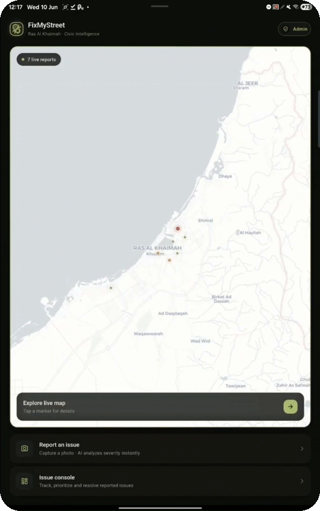<br><sub>Home — live map with report counter</sub></td>
    <td align="center">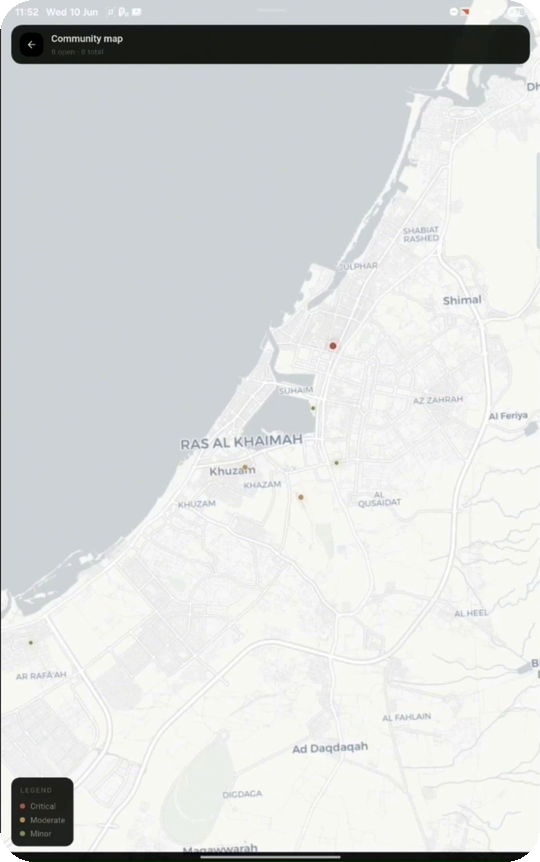<br><sub>Full-screen community map with legend</sub></td>
  </tr>
</table>

The home screen is a **live operational picture of Ras Al Khaimah**:

- Every report renders as a **severity-coded marker**: 🔴 **Critical** (7–10), 🟠 **Moderate** (4–6) and 🟢 **Minor** (1–3).
- **Critical markers pulse.** An animated ring radiates outward from them, so the most dangerous hazards stand out first.
- A **"N live reports"** counter sits on the map, and the feed **re-polls MongoDB every 3 seconds**. New reports from other phones appear without a refresh.
- The camera is **anchored on RAK** (25.7911° N, 55.9432° E) and **clamped to the UAE's bounds**, so users can't scroll off into the ocean.
- Tapping any marker opens a detail sheet: photo, AI classification, address and volunteer eligibility.

Tiles come from **CARTO's light basemap**, rendered by `flutter_map`. It is lightweight, needs no API key and shows Arabic and English place names.

### 3 · Vision AI triage

<table>
  <tr>
    <td align="center"><br><sub>Inference in flight</sub></td>
    <td align="center"><br><sub>Model output: <i>Litter Accumulation · 4/10</i></sub></td>
    <td align="center">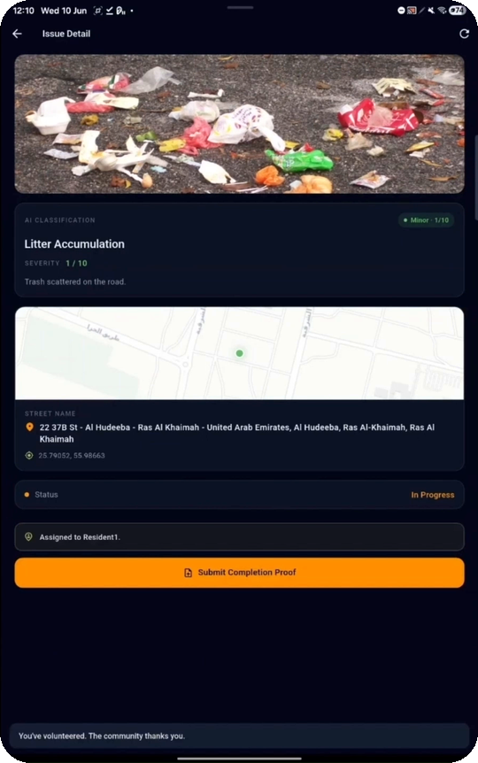<br><sub>Persisted record: reconciled to <b>1/10</b></sub></td>
  </tr>
</table>

This is the core of the system. When a photo is captured, `AIService` sends it, base64-encoded, to **Meta's Llama 4 Scout (17B, 16-expert mixture-of-experts)**. The request goes through **Groq's** OpenAI-compatible inference endpoint for low-latency responses.

**Prompt engineering:**

- The system prompt casts the model as a **"senior municipal-maintenance inspector for Ras Al Khaimah"**.
- The model must reply with **only** a JSON object holding exactly three keys: `category`, `severity` and `description`.
- The allowed category list is **generated at runtime** from a single source of truth (`lib/core/issue_categories.dart`). The prompt, the manual dropdown and the persistence layer can therefore never drift apart.
- A **synonym map** covers colloquial labels: "trash" → *Litter Accumulation*, "lamppost" → *Broken Street Lights*, "spray paint" → *Graffiti*, "sewage" → *Broken Pipelines*.
- If the photo doesn't clearly match a category, the model must answer `"Other"` rather than invent one. The UI then shows a **manual classification dropdown**.
- `temperature: 0.1` keeps classifications repeatable.

**Defensive parsing:** Llama 4 sometimes wraps its output in Markdown fences or adds a `json` prefix. The parser strips both, clamps severity to 1–10, and falls back to a safe "review manually" result rather than crashing. HTTP failures are translated into plain-English messages: `400` bad image, `401` key problem, `429` rate limit, `503` Groq congestion.

**Deterministic severity reconciliation:** the screenshots above show the AI scoring a litter photo **4/10 (Moderate)**. The stored record says **1/10 (Minor)**. That difference is deliberate. Before any report is written, `normalizeSeverityFor()` replaces the model's guess with the **canonical severity for that category**. The AI decides *what* a problem is, and the city's rule table decides *how dangerous* that category is. A model error therefore can't move a live-wire hazard into the volunteer queue, and safe tasks always stay available to the community.

Every report also stores a derived **priority**: High at severity ≥ 7, Medium at 4–6, and Low at 3 or below.

### 4 · Issue Console

<table>
  <tr>
    <td align="center">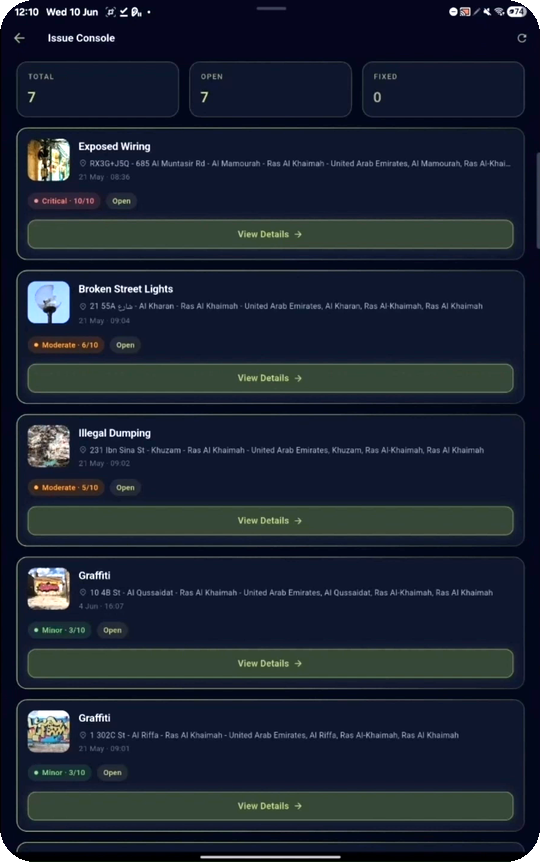<br><sub>7 total · 7 open · 0 fixed</sub></td>
    <td align="center">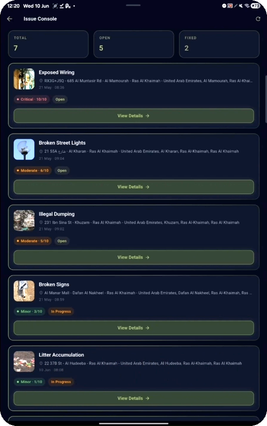<br><sub>After the volunteer loop: fixed count climbs</sub></td>
  </tr>
</table>

The console gives a citywide view of every report:

- **Live KPI tiles**: **Total · Open · Fixed**.
- **Report cards** showing the photo thumbnail, AI category, reverse-geocoded street address, timestamp, a severity chip (e.g. `Critical · 10/10`) and a status chip (`Open`, `In Progress`, `Pending Verification`, `Resolved`).
- One tap opens the full **Issue Detail** view.

### 5 · Severity guardrail

<table>
  <tr>
    <td width="260">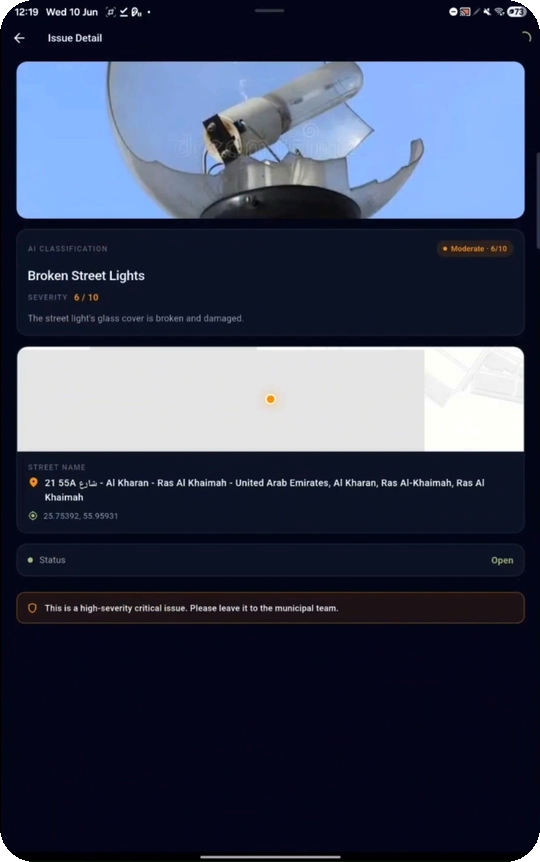</td>
    <td>

Some jobs need a trained crew, not a volunteer with good intentions.

Any report with **severity above 3** is **locked to municipal crews**. The Volunteer button is replaced by a warning:

> ⚠️ *This is a high-severity critical issue. Please leave it to the municipal team.*

The rule applies to **every role, admins included**, and it is enforced in two places:

1. **In the UI**, which hides the volunteer action, and
2. **In the database service**, which **re-reads the report from MongoDB** before any assignment and throws a `VerificationRuleException` if the rule is broken.

Because the check runs against the server copy rather than the screen the user is looking at, a stale screen or a modified client can't get around it.

</td>
  </tr>
</table>

### 6 · Volunteer → Proof → Verify pipeline

Low-risk issues (graffiti, litter, overgrown vegetation, faded markings, damaged signs) become **community micro-tasks** with a full chain of custody:

<table>
  <tr>
    <td align="center">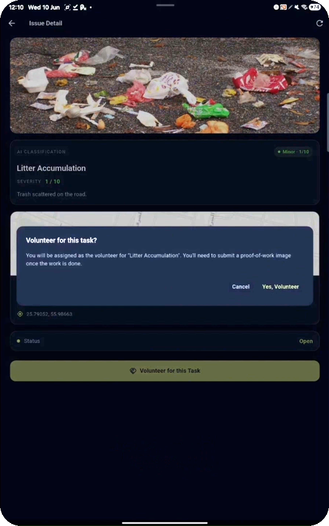<br><b>Volunteer</b><br><sub>Confirm assignment</sub></td>
    <td align="center"><br><b>In Progress</b><br><sub>Assigned · submit proof</sub></td>
    <td align="center">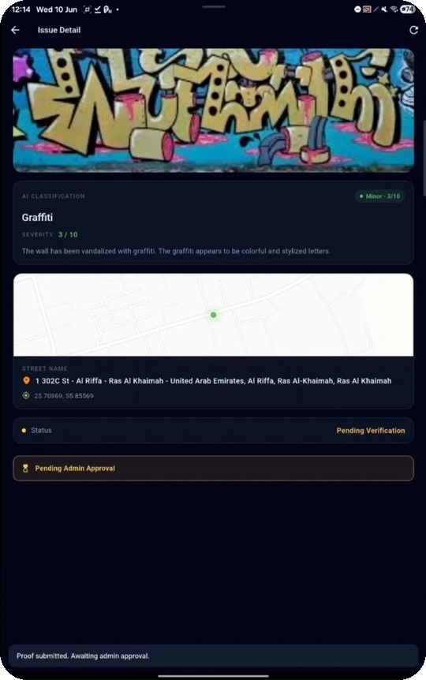<br><b>Pending</b><br><sub>Awaiting admin approval</sub></td>
    <td align="center">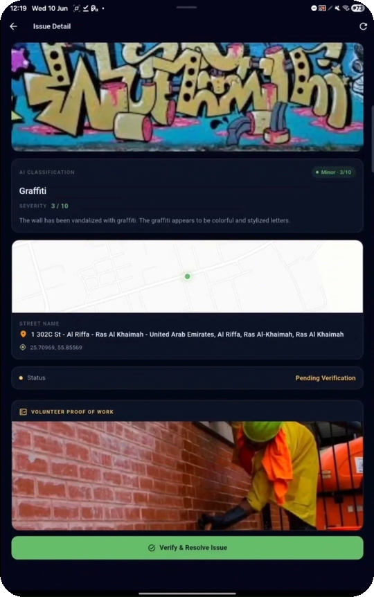<br><b>Verify</b><br><sub>Admin inspects proof</sub></td>
    <td align="center">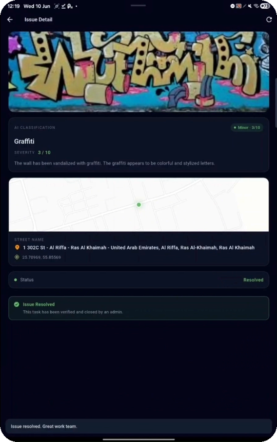<br><b>Resolved</b><br><sub>Closed · +250 EXP</sub></td>
  </tr>
</table>

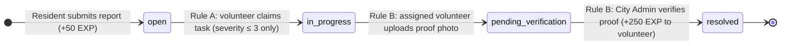

`DatabaseService` holds the only approved transition methods: `volunteerForReport()`, `submitProofOfWork()` and `adminVerifyAndResolve()`. Each one **re-fetches the latest server copy** and checks every precondition before it writes anything:

| Transition | Who | Preconditions enforced server-side |
|---|---|---|
| `open → in_progress` | Any user | Severity ≤ 3 · task not already assigned |
| `in_progress → pending_verification` | **Only the assigned volunteer** | Status is `in_progress` · proof image is non-empty |
| `pending_verification → resolved` | **City Admin only** | Status is `pending_verification` · a proof image exists to inspect |

Resolving a task stamps `fixedAt` in the report's resolution log and credits the volunteer automatically. Older status values (`pending`, `inProgress`, `fixed`) are still parsed, so reports written under the earlier schema load without a migration.

### 7 · Civic EXP economy

<table>
  <tr>
    <td width="260">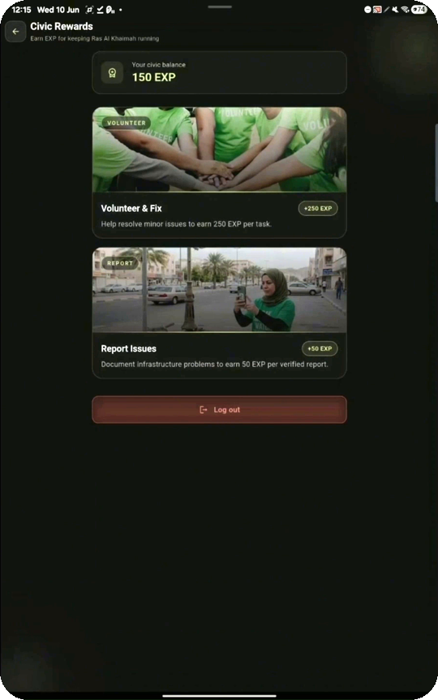</td>
    <td>

Civic participation earns points:

| Action | Reward |
|---|---|
| 📸 Submit a report | **+50 EXP** |
| 🧹 Volunteer, prove and get verified | **+250 EXP** |
| 🌱 Starting balance (resident) | 100 EXP |

- EXP lives in a MongoDB `users` collection and is updated with an **atomic `$inc` upsert**. Simultaneous awards can't overwrite each other, and an account that doesn't exist yet is created with the reward instead of losing it.
- After every award the app **re-reads the document**, so the balance it shows always matches the server.
- The header shows a **progress bar toward the next tier** (200 → 1,000 → 5,000 → every 1,000 after that).

</td>
  </tr>
</table>

### 8 · Self-healing data layer

Mobile networks drop connections, and Atlas closes idle sockets. Rather than assuming the connection is always up, `DatabaseService` was built to recover from failures:

- **Connection lock.** All callers share one in-flight handshake (`_connectFuture`). This fixed a real cold-start race in which `main()` and an early-mounting screen both drove `open()` and one received `State.OPENING`.
- **Retry once on transient errors.** Socket resets and `No master connection` errors trigger a clean reopen and **exactly one retry**. Auth and validation errors fail fast, because reconnecting can't fix them.
- **Pre-flight checks before writes.** If the socket died while the user was on the camera screen, it is revived before `insertOne`, and the submission still goes through.
- **A polling stream that tolerates outages.** It yields a cached list immediately, re-fetches every 3 s, and backs off for 5 s when the network is down rather than hammering a dead socket. The UI never goes blank.
- **Tuned Atlas parameters**: `connectTimeoutMS=30000`, `socketTimeoutMS=60000`, `serverSelectionTimeoutMS=30000` and `maxIdleTimeMS=120000`. Each was set in response to a measured failure on Android-emulator network stacks.

---

## 🏗 System architecture

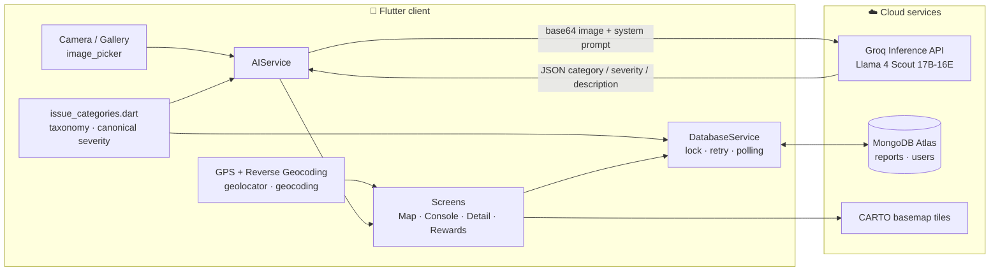

### Lifecycle of a single report

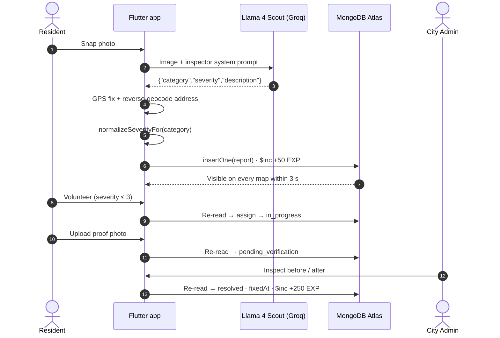

---

## 🗂 The issue taxonomy

Fifteen canonical categories, ordered by risk. The AI must return **exactly one** of these strings or `Other`.

| # | Category | Canonical severity | Band | Volunteer-eligible |
|---|---|:---:|:---:|:---:|
| 1 | Exposed Wiring | 10 | 🔴 Critical | — |
| 2 | Broken Pipelines | 10 | 🔴 Critical | — |
| 3 | Potholes | 8 | 🔴 Critical | — |
| 4 | Traffic Signal Malfunction | 8 | 🔴 Critical | — |
| 5 | Broken Guardrails | 7 | 🔴 Critical | — |
| 6 | Broken Street Lights | 6 | 🟠 Moderate | — |
| 7 | Water Accumulation | 5 | 🟠 Moderate | — |
| 8 | Cracked Sidewalks | 5 | 🟠 Moderate | — |
| 9 | Illegal Dumping | 5 | 🟠 Moderate | — |
| 10 | Overflowing Bins | 4 | 🟠 Moderate | — |
| 11 | Graffiti | 3 | 🟢 Minor | ✅ |
| 12 | Broken Signs | 3 | 🟢 Minor | ✅ |
| 13 | Faded Road Markings | 3 | 🟢 Minor | ✅ |
| 14 | Overgrown Vegetation | 2 | 🟢 Minor | ✅ |
| 15 | Litter Accumulation | 1 | 🟢 Minor | ✅ |

To add or change a category, edit **one file**: `lib/core/issue_categories.dart`. The AI prompt, the manual dropdown, severity reconciliation and volunteer eligibility all update from it automatically.

---

## 🧬 Data model

**`reports` collection**

```jsonc
{
  "_id": ObjectId,
  "category": "Graffiti",                 // one of the 15 canonical categories or "Other"
  "severity": 3,                          // 1–10, reconciled against the canonical map
  "priority": "low",                      // low | medium | high (derived from severity)
  "description": "The wall has been vandalized with graffiti…",
  "latitude": 25.70969,
  "longitude": 55.85569,
  "address": "1 302C St - Al Riffa - Ras Al Khaimah - United Arab Emirates",
  "imageBase64": "…",                     // original report photo
  "status": "pending_verification",       // open | in_progress | pending_verification | resolved
  "createdAt": "2026-06-04T12:07:00Z",
  "fixedAt": null,                        // stamped when resolved
  "assignedVolunteerId": "Resident1",
  "proofOfWorkImageUrl": "data:image/…"   // volunteer's after photo
}
```

**`users` collection**

```jsonc
{ "username": "Resident1", "currentExp": 150, "createdAt": "…" }
```

---

## 🧰 Tech stack

| Layer | Technology | Role |
|---|---|---|
| Client | **Flutter** (Dart 3.11), Material 3 | Cross-platform UI; Android is the primary target |
| Vision AI | **Llama 4 Scout 17B-16E Instruct** | Multimodal issue classification and severity scoring |
| Inference | **Groq** (OpenAI-compatible REST via `http`) | Low-latency model serving |
| Database | **MongoDB Atlas** via `mongo_dart` | Reports, users, EXP ledger |
| Location | `geolocator` · `geocoding` | High-accuracy GPS and reverse-geocoded street addresses |
| Maps | `flutter_map` · `latlong2` · CARTO tiles | Live severity-coded civic map |
| Media | `image_picker` | Camera and gallery capture |
| Formatting | `intl` | Timestamps and locale-aware formatting |
| Dev tooling | `flutter analyze`, `flutter_lints` | Static analysis |

---

## 📁 Project structure

```
fix_my_street/
├── lib/
│   ├── main.dart                     # Boot: MongoDB handshake before runApp()
│   ├── config.dart                   # City scope / defaults
│   ├── core/
│   │   ├── config.dart               # 🔒 API keys + Atlas URI (git-ignored, see setup)
│   │   └── issue_categories.dart     # Single source of truth: taxonomy + canonical severity
│   ├── models/
│   │   ├── ai_analysis_result.dart   # Parsed model output with safe fallback
│   │   ├── app_user.dart             # Roles, EXP, tier progress
│   │   └── report_model.dart         # Report schema, status lifecycle, priority
│   ├── services/
│   │   ├── ai_service.dart           # Groq / Llama 4 vision pipeline
│   │   ├── auth_service.dart         # Role resolution + cache warm-up
│   │   ├── database_service.dart     # Atlas access, verification rules, EXP, self-healing
│   │   └── location_service.dart     # Permissions, GPS, reverse geocoding
│   ├── screens/
│   │   ├── login_screen.dart
│   │   ├── home_screen.dart          # Live map + navigation hub
│   │   ├── map_explore_screen.dart   # Full-screen community map + legend
│   │   ├── map_details_screen.dart   # Marker detail sheet
│   │   ├── camera_screen.dart        # Capture / gallery
│   │   ├── ai_preview_screen.dart    # AI result, manual fallback, submit
│   │   ├── issue_console_screen.dart # KPIs + report list
│   │   ├── issue_detail_screen.dart  # Volunteer → proof → verify UI
│   │   └── exp_info_screen.dart      # Civic Rewards
│   ├── theme/app_theme.dart          # Dark olive design system
│   └── widgets/                      # Buttons, severity chips, pulsing markers, cards
├── assets/images/                    # Logo + reward artwork
└── pubspec.yaml
```

---

## 🚀 Getting started

> **Just want to try it?** Download the APK and install it on your Android device.

### Prerequisites

- Flutter SDK with **Dart ≥ 3.11**
- An Android device or emulator (camera and location permissions required)
- A free **[Groq API key](https://console.groq.com/keys)**
- A **[MongoDB Atlas](https://www.mongodb.com/atlas)** cluster with a database user and your IP or device in the network allow-list

### 1. Clone and install

```bash
git clone https://github.com/SohamBhongade/Fix_My_Street.git
cd Fix_My_Street
flutter pub get
```

### 2. Add your secrets

`lib/core/config.dart` is **git-ignored on purpose**. Create it locally:

```dart
// lib/core/config.dart — DO NOT COMMIT
class AppConfig {
  static const String groqApiKey = 'YOUR_GROQ_API_KEY';
  static const String groqModel = 'meta-llama/llama-4-scout-17b-16e-instruct';

  static const String mongoUri =
      r'mongodb+srv://<user>:<password>@<cluster>.mongodb.net/FixMyStreet?'
      r'retryWrites=true&w=majority&appName=FixMyStreet'
      r'&connectTimeoutMS=30000&socketTimeoutMS=60000'
      r'&serverSelectionTimeoutMS=30000&maxIdleTimeMS=120000';

  static const String reportsCollection = 'reports';
  static const String usersCollection = 'users';
}
```

### 3. Run

```bash
flutter run
```

### Demo accounts

| Role | Username | Password |
|---|---|---|
| Resident | `Resident1` | `123` |
| City Admin | `CityAdmin` | `12345` |

> These are hard-coded **prototype credentials** for demos only. See the [Roadmap](#-roadmap) for real authentication.

---

## 🗺 Roadmap

Where FixMyStreet goes next:

- [ ] **Spatial and visual duplicate detection**: a geo-radius query plus image-similarity check that merges repeat reports into one ticket with community confirmations
- [ ] **AI-assisted proof verification**: the vision model compares before and after photos and gives the admin a confidence score
- [ ] **Municipal web dashboard**: severity heatmaps, district KPIs, crew dispatch and auto-generated work orders
- [ ] **Arabic / RTL interface** for full UAE accessibility
- [ ] **Production authentication** (e.g. Firebase Auth or UAE Pass) replacing the demo accounts
- [ ] **Server-side API layer** (e.g. Cloud Run) so keys and database credentials never ship inside the client
- [ ] **Object storage for images** instead of base64 embedded in report documents
- [ ] **Context-aware follow-up questions** when a photo is ambiguous ("Is the water actively overflowing?")
- [ ] **Push notifications** for nearby volunteer tasks and status changes

---

## 👥 Team

- **Soham Bhongade**
- **Abhinav Arul**
- **Aneeq Mohammed**
- **Nithik Dev**

Originally built for the **ADU hackathon**, and now competing in the **RAK Department of Knowledge × Google** hackathon.

<p align="center">
  <br>
  <sub><b>FixMyStreet AI</b> · Civic intelligence for Ras Al Khaimah</sub>
</p>
